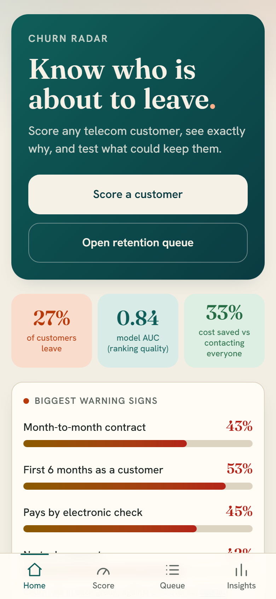
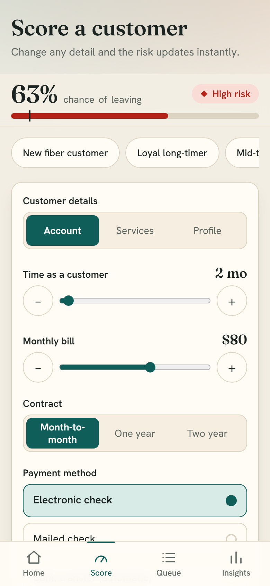
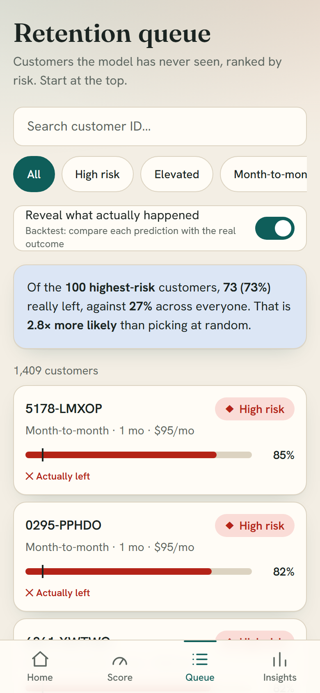
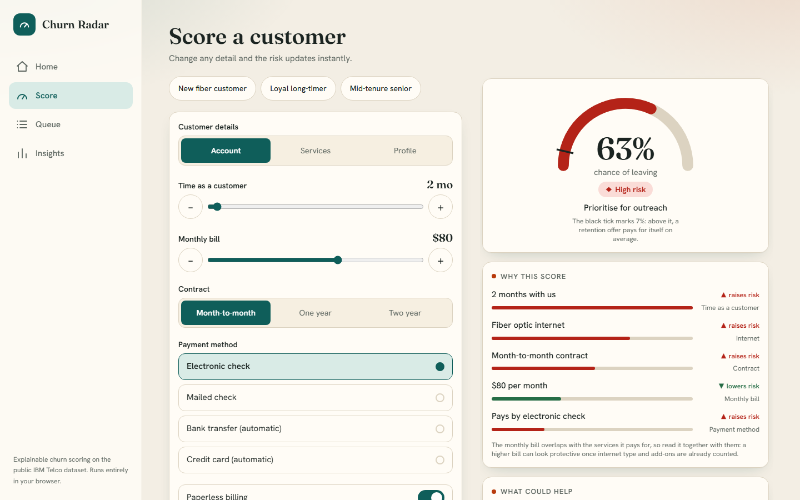
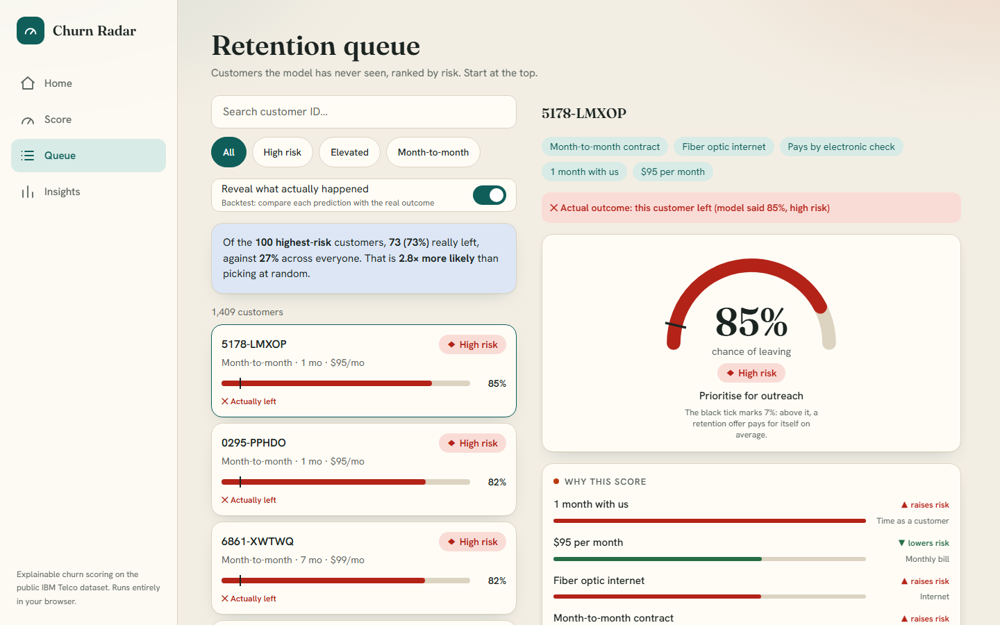
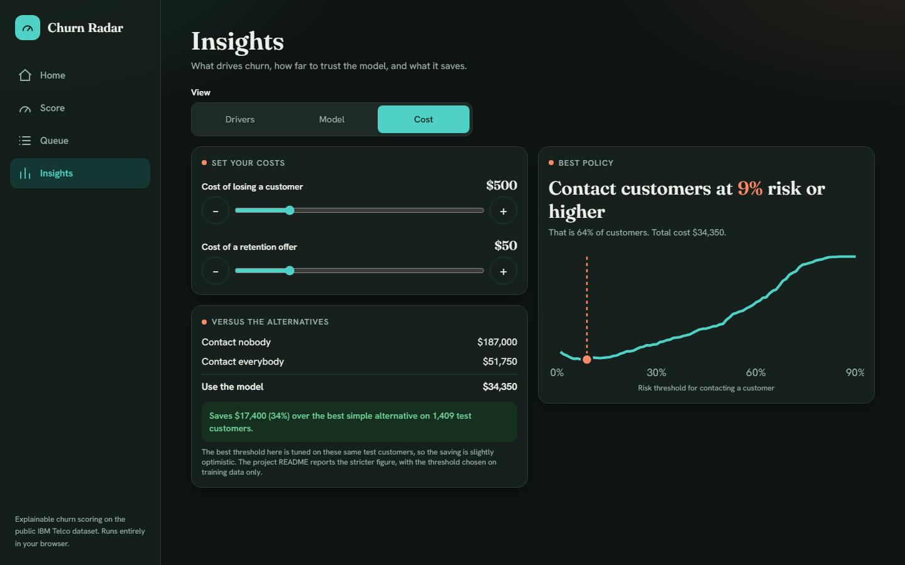

# Churn Radar: Customer Churn Predictor

Predicts which telecom customers are likely to leave and **why**, then turns that into a retention decision using a cost-based threshold. Ships as an installable web app that adapts from phone to laptop.

**Live demo:** https://app-livid-sigma-13.vercel.app (open on a phone and "Add to Home Screen")

**Phone** (bottom tabs, thumb-reach controls):

| Home | Score | Queue + backtest |
|---|---|---|
|  |  |  |

**Laptop** (sidebar, two-pane layouts, light and dark):





## The app

- **Home:** headline numbers, the biggest warning signs, and who to call first.
- **Score:** edit any customer detail and watch the risk, the reasons and the what-if actions update live.
- **Queue:** 1,409 unseen customers ranked by risk, with a **backtest toggle**: of the 100 highest-risk customers, 73 actually left (2.8× the 26.5% base rate).
- **Insights:** churn drivers, a live calibration table (predicted vs actual), model comparison, and a **cost tuner** where you set your own cost of losing a customer and of an offer, and the best threshold and saving recalculate.

Design choices (HCI): responsive layout (bottom tabs on phones, sidebar and two-pane screens on laptops), thumb-reach controls, 44px+ touch targets, one primary action per screen, a sticky live result so every edit gives immediate feedback, inputs constrained to valid combinations (error prevention), recognition over recall (segmented controls and presets), risk shown by text and shape and not by colour alone, light/dark themes, reduced-motion support, keyboard focus and screen-reader labels, and offline support via a service worker.

## Result

On a held-out test set of 1,409 customers (never used for model or threshold selection):

| Metric | Value |
|---|---|
| ROC-AUC | **0.84** |
| Recall at chosen threshold | 97% |
| Precision at chosen threshold | 38% |
| Decision threshold | 7.3% calibrated risk (0.18 on the raw class-weighted score); cost-optimised, not 0.5 |

**Business impact** (assumptions: a missed churner costs $500, a wasted retention offer costs $50):

| Strategy | Cost on test set |
|---|---|
| Contact nobody | $187,000 |
| Contact everybody | $51,750 |
| **Model, optimal threshold** | **$34,450** |

The model cuts cost **33% versus contacting everyone** and 82% versus doing nothing. The comparison with "contact everyone" is the fair one. The dollar values are assumptions; with real costs the threshold would move.

## What drives churn

| Driver | Churn rate |
|---|---|
| Month-to-month contract | 42.7% (two-year: 2.8%) |
| First 6 months of tenure | 52.9% (after 4 years: 9.5%) |
| Fiber optic internet | 41.9% (DSL: 19.0%) |
| Electronic check payment | 45.3% (auto-pay: 15-17%) |
| No tech support | 41.6% (with: 15.2%) |

Gender has no effect (26.9% vs 26.2%). **Recommendations:** target the first six months, move month-to-month customers onto longer contracts, test nudging electronic-check payers to auto-pay, and review fiber pricing and quality.

## Approach

1. **EDA** ([notebooks/01_eda.ipynb](notebooks/01_eda.ipynb)): churn rate by segment, with a business takeaway per chart.
2. **Modeling** ([src/train.py](src/train.py)): 80/20 stratified split *before* any fitting. Logistic regression, random forest and XGBoost compared with 5-fold stratified CV on the training set.

   | Model | CV AUC | CV PR-AUC |
   |---|---|---|
   | Logistic regression | 0.8455 | 0.657 |
   | Random forest | 0.8443 | 0.652 |
   | XGBoost | 0.8459 | 0.664 |

   The three are statistically indistinguishable, so the **simplest model (logistic regression) was chosen**: it is exactly explainable and light enough to run in the browser.
3. **Imbalance** (26.5% churn): class weighting, evaluated with AUC/PR-AUC/recall rather than accuracy.
   Class weighting inflates predicted probabilities (mean 41.6% against a true 26.5%), so scores are **recalibrated with a prior-shift correction** before they are shown as "chance of leaving". On the test set the calibrated mean is 26.7%, and predicted vs actual rates match in every risk band (the Insights screen shows this live). The cost-optimal threshold becomes 7.3%, close to the textbook 50/(500+50) = 9.1%.
4. **Threshold**: chosen on out-of-fold training predictions by minimising expected cost, then evaluated once on the test set.
5. **Explainability** ([src/explain.py](src/explain.py)): SHAP summary plot ([reports/figures/shap_summary.png](reports/figures/shap_summary.png)). For a linear model the per-customer explanation is exact (`coef x (x - mean)`), which the app uses.
6. **App** ([app/](app/)): Next.js + Tailwind. The fitted model is exported to JSON and scored in TypeScript, so no Python runtime or server is needed. [app/lib/verify.mts](app/lib/verify.mts) confirms the TypeScript output matches scikit-learn to 1e-16 on 25 customers.

## Limitations

- Single public dataset (7,043 customers), one point in time; no seasonality or drift check.
- The ranking of SHAP importances is partly shared between correlated features (`tenure`, `TotalCharges`, `MonthlyCharges`), so read it as "which group of features" and not as isolated effects.
- The 38% precision is the price of the 10:1 cost ratio: many flagged customers would have stayed anyway.
- Associations, not causation: a long contract predicts staying, but forcing a contract may not cause it.

## Run it

```bash
python -m venv .venv && .venv\Scripts\activate    # Windows
pip install -r requirements.txt
python src/train.py        # trains, picks the threshold, writes reports/metrics.json + model.joblib
python src/explain.py      # SHAP plot + exports app/public/model.json
python src/export_app_data.py   # segment stats + test customers for the app
python src/make_icons.py        # home-screen icons

cd app
npm install
node --experimental-strip-types lib/verify.mts    # parity check vs scikit-learn
npm run dev
```

Data: [IBM Telco Customer Churn](https://github.com/IBM/telco-customer-churn-on-icp4d) (`data/raw/telco_churn.csv`).

## Stack

Python, pandas, scikit-learn, XGBoost, SHAP, Jupyter / TypeScript, Next.js, Tailwind CSS, Vercel.
